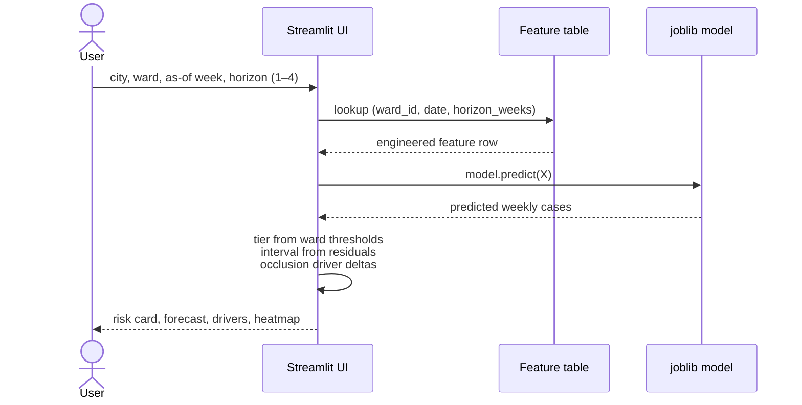

# Architecture — Aedes Sentinel

A local-first dengue early-warning system for Bangladesh. This document covers the data flow,
the chronological validation design, model-selection rationale, and the concrete controls that
keep compute and API cost low.

---

## 1. Problem framing

Dengue is not a same-day weather problem. Urban rainfall fills drains and containers; *Aedes
aegypti* eggs need roughly 1–2 weeks to become adults, then viral incubation and symptom onset
add another delay. The usable warning window is therefore **2–4 weeks after a rain event**.

The dataset also makes risk hyper-local: identical rainfall hits a crowded ward with blocked
drainage and weak waste collection very differently from an adjacent ward. The system therefore
combines **multi-week weather lags** with **ward vulnerability features** instead of ranking
wards on rainfall alone.

---

## 2. System data flow

```mermaid
flowchart LR
    A[Official Google Sheet] -->|one-time gviz CSV| B[(data/raw/<br/>dengue_weather.csv)]
    B --> C[Ingest & schema checks]
    C --> D[Feature pipeline<br/>group by ward_id<br/>1–4 week lags<br/>rolling rainfall<br/>seasonality + vulnerability]
    D --> E[(data/processed/<br/>features.csv)]
    E --> F[Chronological split<br/>train ≤2022 · val 2023 · test 2024–25]
    F --> G[Train + validate]
    G --> H[Serialized artifacts<br/>joblib · feature schema<br/>tier thresholds · metrics]
    E --> I[Streamlit inference]
    H --> I
    I --> J[Risk tier + interval<br/>driver contributions]
    J --> K[Dashboard · city ranking<br/>ward × week heatmap · validation]
```



**Inference path (per user request):**



Nothing in the inference path calls the network. The dataset and model are committed to the
repository, so a fresh clone can launch the app offline.

---

## 3. Feature pipeline

The pipeline is implemented in `src/data/build_features.py` and exported as
`data/processed/features.csv` with one row per **(ward, as-of week, horizon)**.

| Feature group | Examples | Purpose |
|---|---|---|
| Rainfall lags | `rain_lag_1w` … `rain_lag_4w` | Match the mosquito breeding clock; the lagged rain that drives the current case curve |
| Rainfall accumulation | `rain_cum_2w`, `rain_cum_4w` | Sustained standing water, not a single downpour |
| Humidity / temperature lags | `humidity_lag_1w` … `temp_lag_4w`, `humidity_mean_4w`, `temp_mean_4w` | Vector survival and extrinsic incubation |
| Temperature suitability | `temp_suitability` | Binary/continuous suitability band for transmission |
| Case history | `cases_current`, `cases_lag_1w` … `cases_lag_4w` | Autocorrelation and outbreak momentum |
| Seasonality | `week_sin`, `week_cos`, `month` | Monsoon seasonality without a hard-coded calendar rule |
| Ward vulnerability | `population_density_sqkm`, `water_logging_risk_index`, `sanitation_score` | Hyper-local differences under identical rainfall |
| Lead time | `horizon_weeks` (1–4) | One model serves all four warning windows; the app selects the horizon |

**Leakage controls**

- Every lag and rolling statistic is computed **within `ward_id`** after sorting by date.
- Rolling statistics are shifted before use, so a row never sees its own future.
- The split is applied to the **target date**, not the as-of date. Rows whose target crosses a
  split boundary are removed from training.
- Any scaler/imputer is fit on the training window only and serialized inside the estimator
  pipeline.
- The test window is never used for model selection, threshold tuning or prediction intervals.

The independent check `scripts/verify_lags.py` re-derives the lag columns from the raw CSV and
asserts they match the feature table, and flags any row whose target date crosses a split.

---

## 4. Chronological validation split

| Split | Target weeks | Purpose |
|---|---|---|
| **Train** | 2016-01-04 → 2022-12-31 | Fit the model and ward thresholds |
| **Validation** | 2023-01-02 → 2023-12-31 | Model comparison, residual intervals, early stopping |
| **Test** | 2024-01-01 → 2025-12-29 | Untouched chronological holdout for the reported metrics |

Rows are split by **target date**, so a training row cannot predict into the validation or test
window. There is no shuffling and no random `train_test_split`. The test set is used once, after
model selection, for the MAE/RMSE and baseline comparison shown in the **Validation** tab.

**Baselines.** The app reports the trained model against:

- **Seasonal naive** — cases in the same week of the previous year.
- **Persistence** — the most recently observed weekly cases.

A model that cannot beat these baselines is not useful for early warning, regardless of its
in-sample fit.

---

## 5. Model selection rationale

The target is a **weekly count per ward**: non-negative, overdispersed, and zero in roughly 58%
of ward-weeks (mostly outside the monsoon). Weather effects are non-linear and interacting
(e.g., rain only raises risk inside a temperature/humidity band), and the dataset is small
enough that a compact model is preferable to a deep network.

**Candidates considered**

| Candidate | Why it was considered | Why it was not the default |
|---|---|---|
| Ridge / Poisson GLM | Fast, interpretable, strong baseline | Cannot capture non-linear lag interactions without manual splines |
| Random forest | Handles non-linearity, no scaling | Less efficient for counts; can produce unrealistic splits and larger artifacts |
| Gradient boosting (Poisson loss) | Non-linear interactions, count-aware loss, strong tabular performance, CPU-only, small artifact | Slightly harder to explain than a GLM — mitigated with local occlusion explanations |
| Deep sequence model | Could learn long-range patterns | Too data-hungry for 60 wards × 522 weeks; heavier inference and deployment risk |

**Shipped model.** A gradient-boosted regressor with a Poisson loss (scikit-learn
`HistGradientBoostingRegressor` family), trained on the chronological split above. The exact
estimator and metrics are recorded in `models/metrics.json` and rendered in the app.

Why this choice:

- Poisson loss matches non-negative, zero-inflated case counts.
- Trees capture the non-linear lag × humidity × vulnerability interactions without manual
  feature crosses.
- No GPU and no external inference service; the serialized artifact is small and loads in
  milliseconds.
- Feature importances plus single-feature occlusion give a usable driver breakdown without a
  second explanation service.

**Risk tiers.** Predicted weekly cases are mapped to ward-specific **Low / Medium / High /
Critical** thresholds derived from that ward's training distribution (median, p75, p90). This
prevents high-burden wards from being permanently flagged Critical and keeps the tier meaningful
relative to each ward's own history. A half-case floor keeps a near-zero forecast in **Low** even
when a ward's historical median is zero.

**Prediction intervals.** The 80% interval is empirical: the 10th–90th percentile of validation
residuals per horizon, added to the point prediction. It is deliberately simple, reproducible
and does not require a second model.

---

## 6. Compute & API cost controls

| Control | Implementation |
|---|---|
| Runtime API calls | **0**. Dataset and model are bundled; the app makes no outbound request. |
| Data acquisition | `scripts/fetch_data.py` runs once; the 2.5 MB CSV is committed. No per-user or per-render fetch. |
| Model loading | `joblib.load` once per process, memoized with `st.cache_resource`; file mtime invalidates the cache. |
| Data loading | `st.cache_data` keyed on the CSV mtime; the 31k-row raw table loads once, not on every widget interaction. |
| City ranking / heatmap | One vectorized `.predict()` for all wards × horizons; no loop of API calls or per-ward model reloads. |
| Driver explanation | Local single-feature occlusion (≈30 predictions), no SHAP/numba dependency and no external service. |
| LLM usage | **None in the product loop.** No token spend per prediction, per render or per user. The team used AI coding assistants during development only. |
| If an LLM narrative layer is added later | One call per explicit user action, cache keyed by `(ward, as-of, horizon)`, hard cap of ~300 output tokens, local template fallback, and a per-session budget. None of this is needed to run the current app. |
| Hosting | Streamlit on a laptop CPU; no GPU, no paid inference endpoint, no managed database. |
| Latency budget | Warm model + cached data: <300 ms per prediction; the full city heatmap is a single batch prediction. |

**Reproducibility.** `requirements.txt` pins the exact runtime libraries. The dataset and model
artifacts are committed, so a judge needs only `git clone`, `pip install -r requirements.txt`
and `streamlit run app.py`. The app fails loudly with a clear message if an artifact is missing;
it never falls back to hard-coded predictions.

---

## 7. Limitations and production path

- **Historical, not live.** The prototype uses the historical ward-week record. Production would
  add a cached daily weather adapter, a scheduled retrain, and model/version monitoring.
- **Weekly resolution.** This matches the surveillance data; daily lags would need finer input.
- **No ward geometry.** The dataset has no coordinates or polygons, so the heatmap is a
  ward × week matrix rather than a geographic map. Adding ward boundaries is the next visual
  step, not a modeling change.
- **Decision support, not diagnosis.** The tier is a planning signal for vector control and
  hospital readiness; it is not a clinical test.
- **Distribution shift.** A new serotype, reporting change or large population movement can
  break the learned relationships; the validation dashboard and a retrain schedule are the
  safeguards.

---

## 8. Repository map

```text
app.py                    Streamlit entry; tabs, controls, rendering
src/config.py             paths, labels, tier palette
src/data_access.py        cached raw/feature loaders + ward context
src/inference.py          artifact loading, prediction, tiers, intervals, occlusion
src/charts.py             Plotly gauge, forecast, drivers, heatmap, validation
src/data/build_features.py  feature pipeline (ML owner)
src/model/train.py        training + artifact export (ML owner)
data/raw/                 bundled official dataset
data/processed/           engineered feature table
models/                   joblib model + schema + thresholds + metrics + test predictions
scripts/fetch_data.py     one-time dataset refresh
scripts/verify_lags.py    independent lag / leakage checks
```
