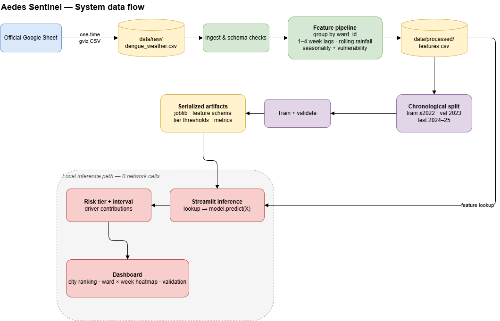
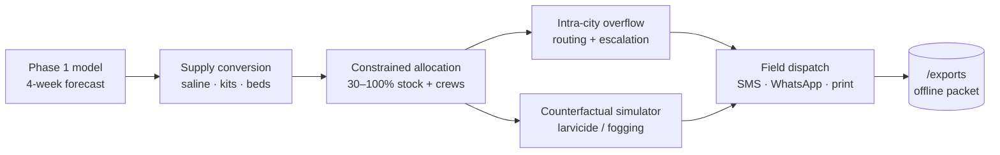

# Architecture — Aedes Sentinel

A local-first dengue early-warning system for Bangladesh. This document covers the data flow,
the chronological validation design, model-selection rationale, and the concrete controls that
keep compute and API cost low.

---

## 1. Problem framing

Dengue is not a same-day weather problem. Urban rainfall fills drains and containers; *Aedes
aegypti* eggs need roughly 1–2 weeks to become adults, then viral incubation and symptom onset
add another delay. The usable warning window is therefore **2–4 weeks after a rain event**.

The dataset also makes risk hyper-local: identical rainfall hits a crowded ward with blocked
drainage and weak waste collection very differently from an adjacent ward. The system therefore
combines **multi-week weather lags** with **ward vulnerability features** instead of ranking
wards on rainfall alone.

---

## 2. System data flow

The inference path is local: feature-table lookup → `model.predict(X)` → tier from ward
thresholds, interval from validation residuals, and occlusion driver deltas. Nothing in this path
calls the network; the dataset and model are committed, so a fresh clone launches offline.

---

## 3. Feature pipeline

The pipeline is implemented in `src/data/build_features.py` and exported as
`data/processed/features.csv` with one row per **(ward, as-of week, horizon)**.

| Feature group | Examples | Purpose |
|---|---|---|
| Rainfall lags | `rain_lag_1w` … `rain_lag_4w` | Match the mosquito breeding clock; the lagged rain that drives the current case curve |
| Rainfall accumulation | `rain_cum_2w`, `rain_cum_4w` | Sustained standing water, not a single downpour |
| Humidity / temperature lags | `humidity_lag_1w` … `temp_lag_4w`, `humidity_mean_4w`, `temp_mean_4w` | Vector survival and extrinsic incubation |
| Temperature suitability | `temp_suitability` | Binary/continuous suitability band for transmission |
| Case history | `cases_current`, `cases_lag_1w` … `cases_lag_4w` | Autocorrelation and outbreak momentum |
| Seasonality | `week_sin`, `week_cos`, `month` | Monsoon seasonality without a hard-coded calendar rule |
| Ward vulnerability | `population_density_sqkm`, `water_logging_risk_index`, `sanitation_score` | Hyper-local differences under identical rainfall |
| Lead time | `horizon_weeks` (1–4) | One model serves all four warning windows; the app selects the horizon |

**Leakage controls**

- Every lag and rolling statistic is computed **within `ward_id`** after sorting by date.
- Rolling statistics are shifted before use, so a row never sees its own future.
- The split is applied to the **target date**, not the as-of date. Rows whose target crosses a
  split boundary are removed from training.
- Any scaler/imputer is fit on the training window only and serialized inside the estimator
  pipeline.
- The test window is never used for model selection, threshold tuning or prediction intervals.

The independent check `scripts/verify_lags.py` re-derives the lag columns from the raw CSV and
asserts they match the feature table, and flags any row whose target date crosses a split.

---

## 4. Chronological validation split

| Split | Target weeks | Purpose |
|---|---|---|
| **Train** | 2016-01-11 → 2022-12-26 · 364 weeks | Fit the model and ward thresholds |
| **Validation** | 2023-01-02 → 2023-12-25 · 52 weeks | Model comparison, residual intervals |
| **Test** | 2024-01-01 → 2025-12-29 · 105 weeks | Untouched chronological holdout for the reported metrics |

Rows are split by **target date**, so a training row cannot predict into the validation or test
window. There is no shuffling and no random `train_test_split`. The test set is used once, after
model selection, for the MAE/RMSE and baseline comparison shown in the **Validation** tab.

**Baselines.** The app reports the trained model against:

- **Seasonal naive** — cases in the same week of the previous year.
- **Persistence** — the most recently observed weekly cases.

A model that cannot beat these baselines is not useful for early warning, regardless of its
in-sample fit.

---

## 5. Model selection rationale

The target is a **weekly count per ward**: non-negative, overdispersed, and zero in roughly 58%
of ward-weeks (mostly outside the monsoon). Weather effects are non-linear and interacting
(e.g., rain only raises risk inside a temperature/humidity band), and the dataset is small
enough that a compact model is preferable to a deep network.

**Candidates considered**

| Candidate | Why it was considered | Why it was not the default |
|---|---|---|
| Ridge / Poisson GLM | Fast, interpretable, strong baseline | Cannot capture non-linear lag interactions without manual splines |
| Random forest | Handles non-linearity, no scaling | Less efficient for counts; can produce unrealistic splits and larger artifacts |
| Gradient boosting (Poisson loss) | Non-linear interactions, count-aware loss, strong tabular performance, CPU-only, small artifact | Slightly harder to explain than a GLM — mitigated with local occlusion explanations |
| Deep sequence model | Could learn long-range patterns | Too data-hungry for 60 wards × 522 weeks; heavier inference and deployment risk |

**Shipped model.** A gradient-boosted regressor with a Poisson loss (scikit-learn
`HistGradientBoostingRegressor`), trained on the chronological split above. The exact estimator
and metrics are recorded in `models/metrics.json` and rendered in the app. On the untouched
2024–2025 holdout the model reaches **MAE 1.05** and **RMSE 2.10** cases per ward-week, versus
**1.69** for the seasonal-naive baseline and **1.75** for persistence across all horizons
(1.41 at the +1 week horizon).

Why this choice:

- Poisson loss matches non-negative, zero-inflated case counts.
- Trees capture the non-linear lag × humidity × vulnerability interactions without manual
  feature crosses.
- No GPU and no external inference service; the serialized artifact is small and loads in
  milliseconds.
- Feature importances plus single-feature occlusion give a usable driver breakdown without a
  second explanation service.

**Risk tiers.** Predicted weekly cases are mapped to ward-specific **Low / Medium / High /
Critical** thresholds derived from that ward's training distribution (median, p75, p90). This
prevents high-burden wards from being permanently flagged Critical and keeps the tier meaningful
relative to each ward's own history. A half-case floor keeps a near-zero forecast in **Low** even
when a ward's historical median is zero.

**Prediction intervals.** The 80% interval is empirical: the 10th–90th percentile of validation
residuals per horizon, added to the point prediction. It is deliberately simple, reproducible
and does not require a second model.

**Experimental ensemble (not shipped).** A separate R&D notebook in
`experiments/synthetic_ensemble/` explores a 5-model stack (LightGBM, XGBoost, CatBoost, Random
Forest, Extra Trees + Ridge). It is excluded from the app because it was trained on a **synthetic**
10-ward × 52-week benchmark with a **same-week** target, uses global `<20/<50/<100` tiers, needs
heavy LightGBM/XGBoost/CatBoost dependencies, and its meta-learner is fit on in-sample base
predictions. It is retained for transparency; a real-data version would need per-ward future
targets, out-of-fold meta-features, the app's feature contract and per-ward thresholds.

---

## 6. Operational supply conversion (Phase 2)

The onsite dataset adds `saline_bags_needed`, `diagnostic_kits_needed` and
`hospital_beds_required`. Rather than estimate these from literature, we
reverse-engineered the generator and verified the reproduction on **all 31,320
rows** (`scripts/verify_supply_formulas.py`):

| Target | Function | Rate |
|---|---|---|
| Saline bags | `round(31/13 × cases)` | 2.385 per case |
| Diagnostic kits | `round_half_down(7/6 × cases)` | 1.167 per case |
| Hospital beds | `round_half_down(0.3 × cases)` | 0.30 per case |

Three properties matter for the operational layer:

- **Single source of truth.** `src/operations/supplies.py` is the only place
  cases become supply. Allocation, routing, simulation and dispatch import it,
  so the modules cannot drift apart.
- **No retraining.** Cases and weather are byte-identical to the Phase 1 file;
  only deterministic targets were appended. The holdout-validated forecaster is
  reused unchanged, preserving the reported MAE/RMSE and interval calibration.
- **Smooth forecasts.** Fractional model predictions are converted directly,
  so demand scales continuously before integer rounding. Zero cases map to zero
  supply, and saline ≥ kits ≥ beds holds for every observed row.

The verification script also re-checks weekly coverage, unique keys and Phase 1
continuity, and exits non-zero on any mismatch. Unit tests cover known rows,
monotonicity and the full onsite reproduction (`python -m unittest discover`).

---

## 6A. Operational layer (Phase 2)

### 6A.1 Constrained allocation

`src/operations/allocation.py` is pure and deterministic. Priority is
`0.65 × tier_rank + 0.35 × density_norm`, so a Critical ward in a crowded ward
outranks a Medium ward elsewhere. The algorithm:

1. reserve a **protected floor** (default 10%) for every ward;
2. water-fill the remaining stock in strict priority order;
3. allocate integer units only.

Supplies are the verified demand numbers; crews are derived from tier and
density (Low 0, Medium 1, High 2, Critical 3, plus one for a dense High/Critical
ward). The UI exposes stock and total crews as live sliders and recomputes the
whole 60-ward ledger in one vectorized pass. Invariant tests prove:

- **monotonicity** — raising available stock never reduces any ward's allocation;
- **conservation** — allocated ≤ available for every commodity;
- **caps** — no ward receives more than its requirement.

### 6A.2 Intra-city overflow routing

Bed capacity is not in the dataset. The prototype uses a transparent planning
baseline: each ward's **75th-percentile historical weekly bed demand** from the
onsite file, minimum 2 beds. The UI exposes a 0.6–2.0× multiplier so the router
can be stress-tested live.

`route_overflow()` computes each ward's unmet demand, sorts donors by lowest
utilization, and routes patients to available headroom **inside the same city
pool** (Dhaka North, Dhaka South, Chattogram, Gazipur, Narayanganj). It returns
the transfer list, net deficits, city utilization and an escalation flag when a
city cannot absorb its own demand. Tests verify no cross-city transfer, no donor
above headroom, and that transfers exactly resolve the routed deficit.

### 6A.3 Model-driven counterfactual simulator

The simulator does not apply a hardcoded percentage. For each simulated week it:

1. reads the real feature row for that ward/week;
2. rewrites the case-history features with the arm's simulated history;
3. applies the intervention at feature level —
   larvicide scales breeding-habitat features (`rain_lag_*`, `rain_cum_*`,
   effective waterlogging risk), fogging scales case-history and the
   vector-pressure proxy;
4. re-runs the **serialized Phase 1 model**;
5. feeds the prediction back into next week's case lags.

Downstream beds and saline use the same verified conversion. Efficacy curves are
conservative planning assumptions (larvicide builds over 2–3 weeks and lasts
longer; fogging acts quickly with a short residual); crews have diminishing
returns (zero crews = no effect, one crew = 75%, two = full nominal effect).
`simulate()` returns per-week baseline/intervention cases, beds and saline plus
an ROI table (`cases prevented per crew`). The zero-crew test asserts the
intervention arm is identical to baseline to 1e-6.

### 6A.4 Dispatch and offline resilience

`src/operations/dispatch.py` builds all three channels from one validated set of
numbers using `str`/HTML templates only. The SMS is capped at 160 characters;
the printable brief is a self-contained HTML file with inline print CSS; the
WhatsApp message lists allocated vs required, deficits and overflow routes.
`write_exports()` writes the packet to `/exports`.

`scripts/offline_check.py` blocks `socket.socket`, `socket.create_connection`
and `socket.getaddrinfo`, then runs forecast → allocation → routing →
simulation → dispatch to completion. This is the live kill-switch proof: if any
module silently reached for the network, the script would fail.

---

## 7. Compute & API cost controls

| Control | Implementation |
|---|---|
| Runtime API calls | **0**. Dataset and model are bundled; the app makes no outbound request. |
| Data acquisition | `scripts/fetch_data.py` runs once; the 2.5 MB Phase 1 CSV and 2.7 MB onsite CSV are committed. No per-user or per-render fetch. |
| Model loading | `joblib.load` once per process, memoized with `st.cache_resource`; file mtime invalidates the cache. |
| Data loading | `st.cache_data` keyed on the CSV mtime; the 31k-row raw table loads once, not on every widget interaction. |
| City ranking / heatmap | One vectorized `.predict()` for all wards × horizons; no loop of API calls or per-ward model reloads. |
| Phase 2 allocation / routing | Pure NumPy/pandas water-filling and greedy matching; no MILP solver, no external service. |
| Phase 2 simulation | A few dozen local `model.predict()` calls per ward-week; no GPU and no LLM. |
| Dispatch | `str`/HTML templates, capped SMS; zero tokens and zero network calls. |
| Offline proof | `scripts/offline_check.py` runs the full pipeline with sockets blocked. |
| Driver explanation | Local single-feature occlusion (≈30 predictions), no SHAP/numba dependency and no external service. |
| LLM usage | **None in the product loop.** No token spend per prediction, per render or per user. The team used AI coding assistants during development only. |
| If an LLM narrative layer is added later | One call per explicit user action, cache keyed by `(ward, as-of, horizon)`, hard cap of ~300 output tokens, local template fallback, and a per-session budget. None of this is needed to run the current app. |
| Hosting | Streamlit on a laptop CPU; no GPU, no paid inference endpoint, no managed database. |
| Latency budget | Warm model + cached data: <300 ms per prediction; the full city heatmap is a single batch prediction. |

**Reproducibility.** `requirements.txt` pins the exact runtime libraries. The dataset and model
artifacts are committed, so a judge needs only `git clone`, `pip install -r requirements.txt`
and `streamlit run app.py`. The app fails loudly with a clear message if an artifact is missing;
it never falls back to hard-coded predictions.

---

## 8. Limitations and production path

- **Historical, weekly, no ward geometry.** The prototype uses the historical ward-week record;
  a production path adds a cached live-weather adapter, a retrain schedule and ward boundaries.
- **Decision support, not diagnosis.** Risk tiers are a planning signal for vector control and
  hospital readiness, not a clinical test.
- **Distribution shift.** A new serotype, reporting change or population movement can break the
  learned relationships; the validation dashboard and retraining are the safeguards.

The Streamlit shell is a thin router over four pages; only the **Dashboard** page imports
pandas/scikit-learn and loads the feature table/model. See `README.md` for the full repository map.
