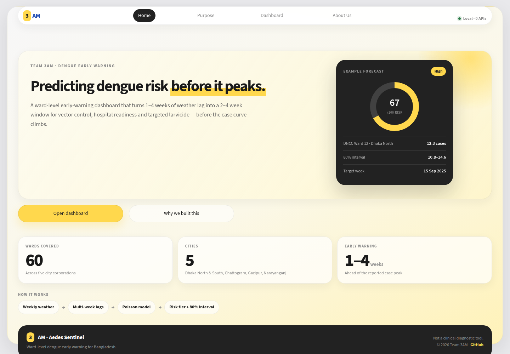
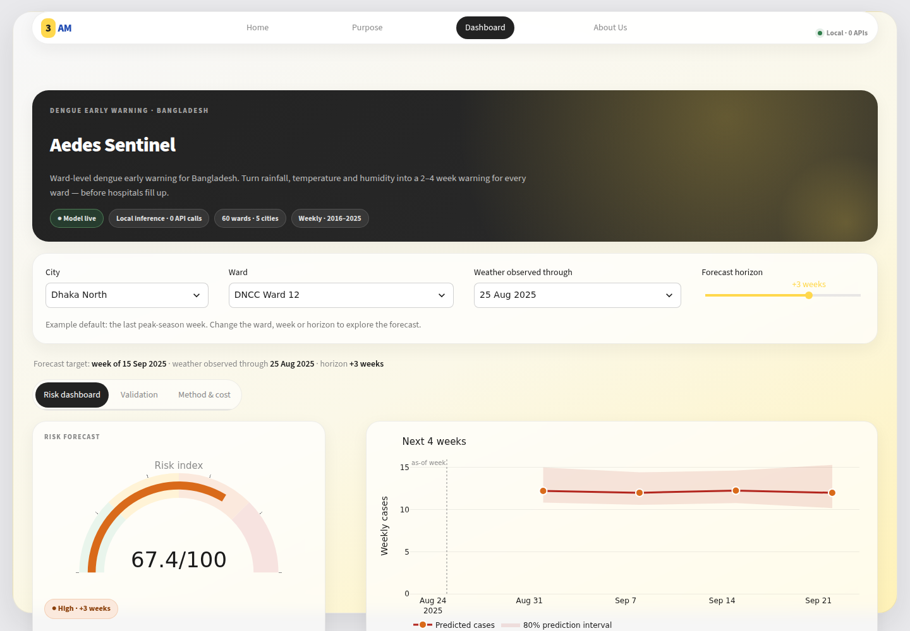
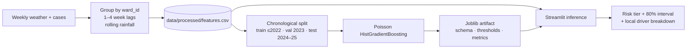

# Aedes Sentinel

**Ward-level dengue early warning for Bangladesh — a 2–4 week window to act before outbreaks peak.**


> **Team 3AM** · Built for the **Hackathon Phase 2: 10-Hour Onsite Final — AI for Urban Dengue Outbreak**.
>
> **Live app:** [project3am.streamlit.app](https://project3am.streamlit.app/) · **Offline-first** · **0 runtime APIs**



*Team 3AM landing page: warm visual shell, one-click entry to the dashboard, and the project's 60-ward / 5-city / 1–4-week scope.*



*Live dashboard: ward-level risk tier, 4-week forecast with an 80% interval, driver breakdown and vulnerability context.*

---

## Contents

- [Demo video](#demo-video)
- [Quickstart](#quickstart-under-3-minutes)
- [The app](#the-app)
- [What the dashboard shows](#what-the-dashboard-shows)
- [Dataset](#dataset)
- [How the pipeline works](#how-the-pipeline-works)
- [Model and validation](#model-and-validation)
- [Reproducing the model](#reproducing-the-model)
- [Testing](#testing)
- [Project structure](#repository-layout)
- [Compute and API cost](#compute-and-api-cost)
- [Security and privacy](#security-and-privacy)
- [Team and contributions](#team-and-contributions)
- [AI assistants and external APIs](#ai-assistants-and-external-apis)
- [Limitations](#limitations)
- [Troubleshooting](#troubleshooting)
- [License](#license)

---

## At a glance

| | |
|---|---|
| **Problem** | Dengue outbreaks in Bangladesh; vector control often starts after hospital admissions climb. |
| **Approach** | Weekly ward weather + 1–4 week lags + vulnerability → Poisson gradient boosting → risk tier + 80% interval. |
| **Coverage** | 60 wards, 5 cities, 2016–2025, weekly resolution. |
| **Model** | `HistGradientBoostingRegressor(loss="poisson")`, 32 features, serialized with joblib. |
| **Holdout** | MAE **1.05**, RMSE **2.10** cases per ward-week across all horizons (0.98 at +1 week); seasonal-naive 1.69; persistence 1.41 at +1 week / 1.75 across horizons. |
| **Phase 2** | Constrained allocation, intra-city overflow routing, model-driven crew counterfactuals, offline dispatch and a read-only grounded assistant. |
| **Interface** | Streamlit, six pages, local CPU, **0 runtime APIs**. |
| **Team** | Team 3AM. |

---

## Demo video

**Phase 2 onsite walkthrough (7:00, uncut):** _link added before submission._
Script: [`docs/DEMO_SCRIPT_PHASE2.md`](docs/DEMO_SCRIPT_PHASE2.md)

**Phase 1 remote qualifier (3:00):** _link added before submission._
Script: [`docs/DEMO_SCRIPT.md`](docs/DEMO_SCRIPT.md)

**Q&A preparation:** [`docs/QA_DEFENSE.md`](docs/QA_DEFENSE.md) — 19 rehearsed questions
with the exact numbers and the honest assumptions behind them.

**Judge reference PDF:** [`docs/Aedes_Sentinel_Model_System_Design.pdf`](docs/Aedes_Sentinel_Model_System_Design.pdf) —
model, split, five Phase 2 capabilities, complete system design and Q&A short answers.
Source: [`docs/MODEL_AND_SYSTEM_QA.md`](docs/MODEL_AND_SYSTEM_QA.md).

<!-- Replace the lines above with unlisted YouTube/Drive links before submission. -->

---

## Quickstart (under 3 minutes)

**Requirements:** Python 3.11 or 3.12 (tested on both), no API keys, no external services.

```bash
git clone https://github.com/faisalkhabirr/Project-3-Am.git
cd Project-3-Am

python -m venv .venv
source .venv/bin/activate          # Linux / macOS
# Windows PowerShell: .venv\Scripts\Activate.ps1
# Windows cmd:       .venv\Scripts\activate

pip install -r requirements.txt
streamlit run app.py
```

Open **http://localhost:8501**.

**Live deployment:** [https://project3am.streamlit.app/](https://project3am.streamlit.app/)

The dataset and serialized model are committed to the repo, so the app runs fully offline.
There is no build step, no database, and no network call at runtime.
Deployment and live-URL steps: [`docs/DEPLOYMENT.md`](docs/DEPLOYMENT.md).

> If `python` is not 3.11/3.12, create the venv explicitly:
> `py -3.12 -m venv .venv` (Windows) or `python3.12 -m venv .venv`.
> The first dashboard render loads the 33 MB feature table and model; later interactions are cached.

<details>
<summary>Fast path with uv (optional)</summary>

```bash
uv venv --python 3.12 .venv
uv pip install --python .venv/bin/python -r requirements.txt
.venv/bin/streamlit run app.py
```
</details>

---

## The app

The app has six pages, connected by the fixed pill navigation and the footer:

| Page | What it does |
|---|---|
| **Home** | Landing page: the 2–4 week warning story, 60 wards / 5 cities / 1–4 weeks, and a one-click entry to the dashboard. |
| **Purpose** | Why dengue early warning matters in Bangladesh, the breeding clock, hyper-local vulnerability, and who the tool helps. |
| **Dashboard** | The working analytical page: ward risk, forecast, drivers, vulnerability, city ranking, heatmap, validation and method/cost tabs. |
| **Command Center** | Phase 2 operations: scarcity-aware allocation, intra-city overflow routing, counterfactual crew simulation and offline dispatch exports. |
| **Assistant** | Messenger-style, read-only assistant grounded in the live scenario: ward gaps, overflow routes, supply math, crew priority, stock what-ifs and model calibration. Commissioner / hospital-manager wording. |
| **About Us** | Team 3AM, roles, and the project-info card (model, coverage, runtime). |

The landing page opens first. Click **Open dashboard**, use the nav pill, or open
`?page=dashboard` directly. The operational layer is at `?page=command`.

---

## What the dashboard shows

| Area | What you get |
|---|---|
| **Risk forecast** | Ward-specific **Low / Medium / High / Critical** tier, predicted weekly cases, and an 80% prediction interval for a chosen lead time (1–4 weeks). |
| **Driver breakdown** | Local, model-agnostic contribution bars: which weather lags and vulnerability features push the forecast up or down. |
| **Weather context** | Rainfall 1–4 weeks ago, 4-week rainfall totals, humidity and temperature percentiles, plus the historical rainfall-vs-cases curve with the 2–4 week lag window highlighted. |
| **Ward vulnerability** | Population density, waterlogging risk and sanitation score — why identical rainfall produces different risk in adjacent wards. |
| **City view** | Ranked ward table and ward-level risk chart for the selected city/week. |
| **Ward × week heatmap** | Predicted weekly cases for every ward in the city across the next four weeks. |
| **Validation** | Chronological holdout MAE/RMSE, seasonal-naive and persistence baselines, actual-vs-predicted curve, and error by horizon. |
| **Method & cost** | Lag definitions, split logic, model rationale, and the concrete cost/API controls. |

---

## Phase 2 command center

The onsite layer turns the forecast into a Monday-morning operating picture. It is a
dedicated set of pages and is entirely local.

| Page / tab | What it does |
|---|---|
| **Allocate** | Converts predicted cases to saline, kits and beds with the verified dataset formulas, then allocates under a **30–100% regional stock** slider. Every ward gets a protected 10% floor; the remainder is water-filled by risk tier × population density. Deficit badges and city roll-ups update live. A **conservative planning** toggle sizes demand against the 80% upper interval. |
| **Overflow** | Derives each ward's bed capacity from its historical 75th-percentile weekly demand (minimum 2 beds), then routes deficits to lower-burden wards **inside the same city**. Shows transfers, net deficits, city utilization and a regional escalation flag when a whole city is exhausted. A capacity multiplier lets judges stress-test the router. |
| **Simulate** | Deploy larvicide or fogging crews to selected wards for 2–4 weeks. The simulator rewrites the relevant feature block, re-runs the serialized model, feeds predictions back into next week's case lags, and ranks wards by **cases prevented per crew**. Zero crews reproduces the baseline exactly. |
| **Dispatch** | Builds a ≤160-character SMS, a WhatsApp message and a printable HTML commissioner brief from the same allocation. Exports to `/exports`; no LLM or network call is involved. |

**Assistant.** A separate Messenger-style page answers read-only questions from the current
scenario: “Why is my ward short?”, “Where does overflow go?”, “What if stock is 30%?”, “How
accurate is the forecast?”. It also accepts **natural-language verification**: describe the
scenario and expected result in words — for example, “At 60% stock with 8 crews, regional saline
should be 749 of 1,249, and 31 of 60 wards should have a supply gap” — and it parses the
scenario, re-runs the engine, and returns an expected-vs-actual PASS/FAIL table. It uses a
deterministic intent/check parser over the live allocation, routing and committed metrics — no
LLM and no external API. A Commissioner / Hospital-manager toggle changes the guidance without
changing the numbers.

**Allocation rule.** `allocate()` is pure and deterministic: protected floor → strict priority
water-filling → integer units. The invariant tests prove monotonicity (more stock never reduces
any ward's allocation) and conservation (allocated ≤ available for every commodity). The UI
reports **Supply %** and **Crew %** separately, so a ward with full supplies but no crew is still
flagged as short.

**Simulator honesty.** Efficacy curves are conservative planning assumptions (larvicide builds
over 2–3 weeks; fogging acts quickly with a short residual). Because the model has no explicit
adult-mosquito index, fogging scales the case-history and vector-pressure proxy; this structural
assumption is documented in the module docstring and in Q&A.

**Offline proof.** `python scripts/offline_check.py` blocks sockets, then runs forecast →
allocation → routing → assistant → simulation → dispatch to completion. It is the live
kill-switch test.

**Accuracy proof.** `python scripts/verify_accuracy.py` prints per-horizon MAE/RMSE, bias and
empirical 80% interval coverage, and exits non-zero if the model fails to beat either baseline
or if coverage leaves the 75–85% band.

---

## Dataset

The Phase 1 columns are bundled at `data/raw/dengue_weather.csv`. The **training and
operational source of truth is `data/raw/dengue_onsite.csv`**, which contains the same
31,320 ward-weeks plus three supply targets:

| Column | Description |
|---|---|
| `date` | Weekly observation date (Mondays), 2016-01-04 → 2025-12-29. |
| `city` | Dhaka North, Dhaka South, Chattogram, Gazipur, Narayanganj. |
| `ward_id` | 60 ward keys; 20 / 20 / 10 / 5 / 5 across the five cities. |
| `population_density_sqkm` | Static ward crowding. |
| `water_logging_risk_index` | Static drainage / standing-water risk. |
| `sanitation_score` | Static waste-collection score. |
| `avg_temp_c` | Weekly average temperature (the brief's `avg_temp_C`). |
| `max_temp_c`, `min_temp_c` | Weekly temperature range. |
| `rainfall_mm` | Weekly rainfall. |
| `relative_humidity_pct` | Weekly relative humidity. |
| `dengue_cases` | Weekly reported cases, per ward (0–41; mean 2.64; 58% zero weeks). |

- **31,320 rows** = 60 wards × 522 weeks.
- **Period:** 2016-01-04 → 2025-12-29, weekly.
- **No missing values**; vulnerability columns are static per ward; weather varies per ward.

Data source: [Hackathon Phase 1 dataset](https://docs.google.com/spreadsheets/d/1QFI0ACJRvJQkiQT3LfGHklM3g4PgaJWUt8xSVU07NIE/edit?usp=sharing).

To refresh the Phase 1 provenance copy (not the training source):

```bash
python scripts/fetch_data.py --force
```

### Phase 2 onsite extension

`data/raw/dengue_onsite.csv` is the onsite-phase dataset: the same 31,320
ward-weeks plus three operational targets. We verified that each target is a
**deterministic function of reported cases**, matching all 31,320 rows exactly:

| Column | Verified conversion | Interpretation |
|---|---|---|
| `saline_bags_needed` | `round(31/13 × cases)` | ~2.385 bags per case |
| `diagnostic_kits_needed` | `round_half_down(7/6 × cases)` | 1 test per case + confirmatory buffer |
| `hospital_beds_required` | `round_half_down(0.3 × cases)` | 30% of cases need admission |

Because cases and weather are byte-identical to Phase 1, the model is **trained from
the onsite file** and the three supply columns are **excluded from the model inputs**
(`tests/test_pipeline.py` guards this). The resulting `features.csv`, model artifact
and test predictions are byte-identical to the Phase 1 build; only the `trained_at`
timestamp changes. The conversion lives in `src/operations/supplies.py` and is audited
by `python scripts/verify_supply_formulas.py`.

> Phase 2 build marker: **BLUEPINE**.

---

## How the pipeline works



### Multi-week lag features

| Group | Columns | Why it matters |
|---|---|---|
| Rainfall lags | `rain_lag_1w` … `rain_lag_4w` | The breeding clock: rain 7–28 days before the target week. |
| Rainfall accumulation | `rain_cum_2w`, `rain_cum_4w` | Sustained standing water, not a single downpour. |
| Humidity / temperature | `humidity_lag_1w` … `temp_lag_4w`, `humidity_mean_4w`, `temp_mean_4w`, `temp_suitability` | Vector survival and extrinsic incubation. |
| Case history | `cases_current`, `cases_lag_1w` … `cases_lag_4w` | Outbreak momentum and autocorrelation. |
| Seasonality | `week_sin`, `week_cos`, `month` | Monsoon seasonality without hard-coded rules. |
| Ward vulnerability | `population_density_sqkm`, `water_logging_risk_index`, `sanitation_score` | Hyper-local differences under identical rainfall. |
| Lead time | `horizon_weeks` (1–4) | One model serves all four warning windows. |

**Target definition:** `date` is the as-of week; `target_cases` is the case count at
`date + horizon_weeks weeks`. One row per `(ward_id, date, horizon_weeks)`.

**Leakage controls:**

- Every lag and rolling statistic is computed **within `ward_id`**; no ward borrows another ward's history.
- Rolling features are shifted before use; a row never sees its own future.
- The split is applied to the **target date**, not the as-of date, and rows whose target crosses a split boundary are removed.
- No shuffling; the test window is never used for model selection, thresholds or intervals.

Verify the lag math independently:

```bash
python scripts/verify_lags.py
```

Expected: `PASS — feature table is consistent with the raw ward-week series.`

See **[ARCHITECTURE.md](ARCHITECTURE.md)** for the full data-flow diagram, leakage controls and
model-selection rationale.

---

## Model and validation

The shipped engine is a **Poisson gradient-boosted regressor**
(`HistGradientBoostingRegressor`). It learns non-linear interactions between rainfall lags,
humidity, temperature, seasonality and ward vulnerability, then maps predicted weekly cases
onto ward-specific risk tiers.

| Split | Target weeks | Rows |
|---|---|---|
| **Train** | 2016-01-11 → 2022-12-26 · 364 weeks | 87,000 |
| **Validation** | 2023-01-02 → 2023-12-25 · 52 weeks | 12,480 |
| **Test** | 2024-01-01 → 2025-12-29 · 105 weeks | 25,200 |

| Metric (2024–2025 holdout, all horizons) | Value |
|---|---|
| MAE | **1.05** cases / ward-week |
| RMSE | **2.10** cases / ward-week |
| Seasonal-naive MAE | 1.69 |
| Persistence MAE | 1.75 |

Per-horizon MAE on the test window: **0.98 / 1.00 / 1.03 / 1.21** for +1 / +2 / +3 / +4 weeks.
The exact values are read from `models/metrics.json` and rendered live in the **Validation** tab.

### Risk tiers and intervals

Tiers are **ward-specific**, derived from that ward's training distribution (median, p75, p90).
A half-case floor keeps a near-zero forecast in **Low** even when the median is zero.

| Tier | Rule |
|---|---|
| **Low** | `cases ≤ max(low_max, 0.5)` |
| **Medium** | `≤ medium_max` |
| **High** | `≤ high_max` |
| **Critical** | `> high_max` |

The 80% interval is empirical: the 10th–90th percentile of validation residuals per horizon,
added to the point prediction and clipped at zero. It is deliberately simple, reproducible and
does not require a second model.

### Model card

| | |
|---|---|
| **Intended use** | Ward-level planning for vector control, larvicide/spraying and hospital readiness. |
| **Not intended for** | Clinical diagnosis, individual patient decisions, or real-time outbreak confirmation. |
| **Data** | Weekly aggregate weather and surveillance from the onsite file, 2016–2025; supply targets excluded from model inputs. |
| **Model** | Poisson HistGradientBoosting, 32 features, joblib artifact. |
| **Metrics** | MAE 1.05 / RMSE 2.10 cases per ward-week; beats seasonal and persistence baselines. |
| **Limitations** | Historical data, weekly resolution, no ward geometry, no live weather feed. See [Limitations](#limitations). |

An experimental 5-model stacking ensemble is preserved under
[`experiments/synthetic_ensemble/`](experiments/synthetic_ensemble/). It was trained on a
synthetic benchmark with a same-week target, so it is **not** used by the app and its metrics are
not comparable. The folder's README documents why it was not shipped.

---

## Reproducing the model

The exact artifacts in `models/` are reproducible from the committed pipeline:

```bash
python -m src.data.build_features     # onsite CSV → features.csv (supply targets excluded)
python -m src.model.train             # features → models/ + metrics.json
```

Then verify the inference path:

```bash
python scripts/smoke_test.py
```

Expected: `PASS — inference path is healthy.`

---

## Testing

| Check | Command | Expected |
|---|---|---|
| Data / lag integrity | `python scripts/verify_lags.py` | PASS |
| Model + inference path | `python scripts/smoke_test.py` | PASS |
| Phase 2 supply audit | `python scripts/verify_supply_formulas.py` | PASS, 31,320/31,320 rows per column |
| Forecast accuracy + calibration | `python scripts/verify_accuracy.py` | PASS, MAE 1.054, 80% coverage 81.5% |
| Engine invariants | `python -m unittest discover` | PASS, 43 tests |
| Offline kill-switch | `python scripts/offline_check.py` | PASS with sockets blocked |
| Headless UI flow | `python scripts/ui_smoke_test.py` | Home → Command → 30% stress → counterfactual → Assistant chat, no exceptions |
| Dispatch samples | `python scripts/export_dispatch_samples.py` | 24 files in `exports/` |

The UI tests explicitly cover the three dashboard tabs, the preserved widget keys
(`city_select`, `ward_select_<city>`, `as_of_select`, `horizon_select`, `validation_horizon`),
city/date/horizon changes, and the graceful “Model pending” state.

---

## Repository layout

```text
app.py                      thin router: theme, nav, page dispatch
ui/
  theme.py                  palette, CSS variables, animations
  components.py             navbar, footer, navigation helpers
  pages/                    Home, Purpose, Dashboard, Command, Assistant, About
src/
  config.py                 paths, labels, tier colours
  data_access.py            cached data loaders + ward context
  inference.py              model loading, prediction, tiers, drivers
  charts.py                 Plotly figures
  operations/               Phase 2 engines (offline, deterministic)
    supplies.py             verified case -> saline/kits/beds conversion
    allocation.py           scarcity-aware priority water-filling
    routing.py              intra-city overflow routing + capacity baseline
    simulation.py           model-driven crew counterfactuals
    dispatch.py             SMS / WhatsApp / printable HTML templates
    assistant.py            deterministic, application-aware Q&A
    checks.py               natural-language scenario + assertion evaluator
  data/                     real-data feature pipeline
  model/                    real-data training + artifact export
data/
  raw/dengue_weather.csv    bundled Phase 1 columns (provenance)
  raw/dengue_onsite.csv     Phase 2 training + operations source (+ 3 supply targets)
  processed/features.csv    engineered ward/week/horizon features
exports/                    sample SMS / WhatsApp / printable briefs
models/
  dengue_model.joblib       serialized estimator
  feature_columns.json      ordered model inputs
  risk_thresholds.json      per-ward tier thresholds
  metrics.json              split, metrics, prediction intervals
  test_predictions.csv      chronological holdout predictions
experiments/
  synthetic_ensemble/       synthetic 5-model stack (not shipped)
scripts/
  fetch_data.py             one-time data refresh
  verify_lags.py            independent lag/leakage sanity checks
  verify_supply_formulas.py row-for-row Phase 2 supply audit
  verify_accuracy.py        holdout MAE, baseline lift and 80% interval coverage
  offline_check.py          socket-blocked full-pipeline proof
  ui_smoke_test.py          headless Home -> Command -> simulation -> Assistant
  export_dispatch_samples.py sample SMS / WhatsApp / brief packet
  build_qa_pdf.py           renders the judge reference PDF (dev-only deps)
  smoke_test.py             end-to-end inference check
tests/
  test_supplies.py          supply conversion + full dataset reproduction
  test_operations.py        allocation, routing, simulation, dispatch invariants
  test_pipeline.py          onsite training source, no supply leakage, causal lags
  test_assistant.py         intent routing, role wording, read-only what-if and natural-language checks
docs/
  home.png                  landing page screenshot
  dashboard.png             dashboard screenshot
  DEMO_SCRIPT.md            Phase 1 recording plan
  DEMO_SCRIPT_PHASE2.md     Phase 2 7:00 uncut recording plan
  QA_DEFENSE.md             rehearsed answers and numbers for the 30-point Q&A
  DEPLOYMENT.md             Streamlit Cloud + offline fallback runbook
  MODEL_AND_SYSTEM_QA.md    source for the judge reference PDF
  Aedes_Sentinel_Model_System_Design.pdf  styled 15-page judge reference
ARCHITECTURE.md             system design + validation + cost controls
README.md
LICENSE
requirements.txt
```

---

## Compute and API cost

Aedes Sentinel is designed for a public-health office laptop, not a GPU cluster:

| Control | Implementation |
|---|---|
| Runtime external API calls | **0** — dataset and model are bundled. |
| Data acquisition | One-time `scripts/fetch_data.py`; the CSV is committed. |
| Model loading | `joblib` once per process via `st.cache_resource`. |
| Data loading | `st.cache_data` keyed on file mtime; no per-widget reloads. |
| City ranking / heatmap | One vectorized `.predict()` for all wards × horizons. |
| Driver explanation | Local single-feature occlusion; no SHAP/numba dependency. |
| LLM usage | **None in the product loop** — no tokens per prediction or render. |
| If an LLM narrative layer is added later | One call per explicit action, cache keyed by `(ward, as-of, horizon)`, ~300-token cap, local template fallback. |
| Hosting | Streamlit on a laptop CPU; no GPU, no paid endpoint, no managed database. |
| Latency budget | Warm model + cached data: <300 ms per prediction. |

The detailed control table is in [ARCHITECTURE.md](ARCHITECTURE.md#7-compute--api-cost-controls)
and in the app's **Method & cost** tab.

---

## Security and privacy

- **No patient-level data.** The dataset is ward-week aggregate surveillance and weather.
- **No credentials or secrets** are required or committed.
- **No external calls at runtime**; the app works offline.
- **No clinical use.** Risk tiers are decision support for planning, not a diagnosis.
- The prototype is intended for local/controlled deployment; add authentication and audit logging
  before handling any real operational data.

---

## Team and contributions

**Team 3AM**

| Person | Role |
|---|---|
| **Faisal Khabir** ([@faisalkhabirr](https://github.com/faisalkhabirr)) | Dashboard/UI, real-data feature pipeline, inference integration, validation views, architecture, demo, repo delivery |
| **Muhammad Anamur Rashid** ([@loser-2-o](https://github.com/loser-2-o)) | ML exploration: lag-feature experiments, 5-model ensemble notebook, synthetic benchmark, model packaging |
| **Tanvir Jonayed** ([@tanvir-jonayed](https://github.com/tanvir-jonayed)) | Team collaborator · Student, East Delta University, Chattogram |

Git history is incremental across the build window, with feature, model, notebook and UI work in
separate commits. See the [commit history](https://github.com/faisalkhabirr/Project-3-Am/commits/main)
and the contributor graph.

The **About Us** page mirrors this table with GitHub links.

---

## AI assistants and external APIs

We disclose every AI assistant and external API used in this project, as required by the judging
criteria. AI-assisted code was reviewed and tested by the team before submission.

| Tool / API | Used for | Runtime dependency? |
|---|---|---|
| **OpenCode (DeepSeek V4.1 Flash)** | Coding assistant: Streamlit dashboard, Phase 2 allocation/routing/simulation/dispatch/assistant engines, data-access/inference modules, documentation, integration review | No |
| **Gemini Notebook / NotebookLM (Google)** | Analyzing the hackathon brief and rubric, drafting architecture rationale, rubric-compliance checks, Git workflow assistance | No |
| **Claude (Anthropic)** | Feature-lag pipeline logic, ML code refactoring, Streamlit UI design structure | No |
| **ChatGPT (OpenAI)** | Feature-lag pipeline logic, ML code refactoring, Streamlit UI design structure | No |
| **Google Colab (T4 GPU)** | Development environment for the experimental ensemble notebook | No |
| **Google Sheets `gviz` CSV endpoint** | One-time download of the official hackathon dataset | No — CSV is bundled |
| **LightGBM / XGBoost / CatBoost** | Experimental synthetic ensemble only; **not used by the shipped app** | No — experiment only |
| **scikit-learn / pandas / numpy / joblib** | Training and local inference libraries | Local libraries, no API |
| **Streamlit / Plotly** | Dashboard and charts | Local libraries, no API |

<!-- Add any assistant/API used by Tanvir Jonayed before submission. -->

No LLM API is called when the app runs. No paid inference endpoint, map service, weather API or
database is used at runtime. All AI assistants and external services used by the team are listed
above.

---

## Limitations

- **Historical, not live.** The prototype uses the historical ward-week record, not a live
  weather feed. A production version would add a cached daily weather adapter and a scheduled
  retrain.
- **Weekly resolution.** This matches the surveillance data; daily lags would need finer input.
- **No ward geometry.** The dataset has no coordinates or polygons, so the heatmap is a ward ×
  week matrix rather than a geographic map.
- **Distribution shift.** A new serotype, reporting change or large population movement can break
  the learned relationships; the validation dashboard and a retrain schedule are the safeguards.
- **Decision support, not diagnosis.** The tier is a planning signal for vector control and
  hospital readiness; it is not a clinical test.

---

## Troubleshooting

| Symptom | Fix |
|---|---|
| `streamlit: command not found` | Activate the venv first: `source .venv/bin/activate` (Windows: `.venv\Scripts\Activate.ps1`). |
| Port 8501 already in use | `streamlit run app.py --server.port 8502`. |
| “Model handoff pending” banner | The serialized artifacts are missing; restore `models/` and `data/processed/features.csv`, or run the training pipeline. |
| App starts but no data | Confirm `data/raw/dengue_onsite.csv` exists; the training and operational loaders use it by default. |
| Charts blank for a few seconds | The first dashboard render loads the feature table/model; wait for the warm-up and refresh once. |
| Slow dependency install | Use the uv fast path above, or a faster network; the app itself starts in seconds. |

---

## Development workflow

```bash
git checkout -b feature/<short-name>
# make changes
python scripts/verify_lags.py
python scripts/smoke_test.py
git add -A
git commit -m "Describe the change"
git push origin feature/<short-name>
```

Keep model/data artifacts and the dashboard code in separate commits. Do not commit secrets;
none are required.

---

## License

MIT — see [LICENSE](LICENSE).

The dengue/weather dataset is provided by the hackathon organizers. Check its terms before
redistributing the data outside this project. The risk output is not a clinical diagnosis.

---

## Acknowledgements

- Hackathon Phase 1 organizers and dataset providers.
- The open-source Python, Streamlit, scikit-learn, pandas, NumPy, joblib and Plotly communities.
- Public-health teams working on urban dengue and *Aedes aegypti* control in Bangladesh.
